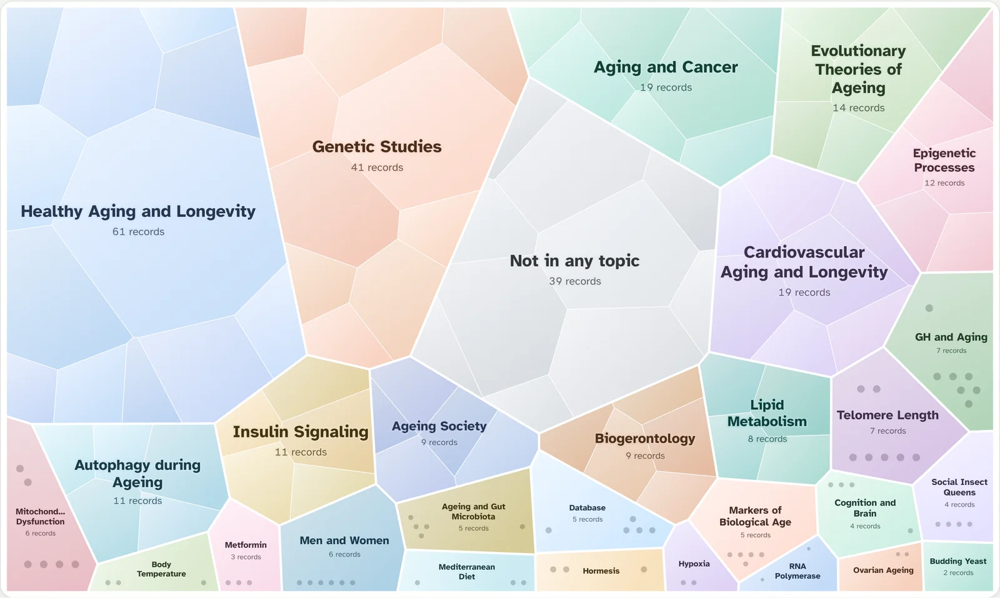
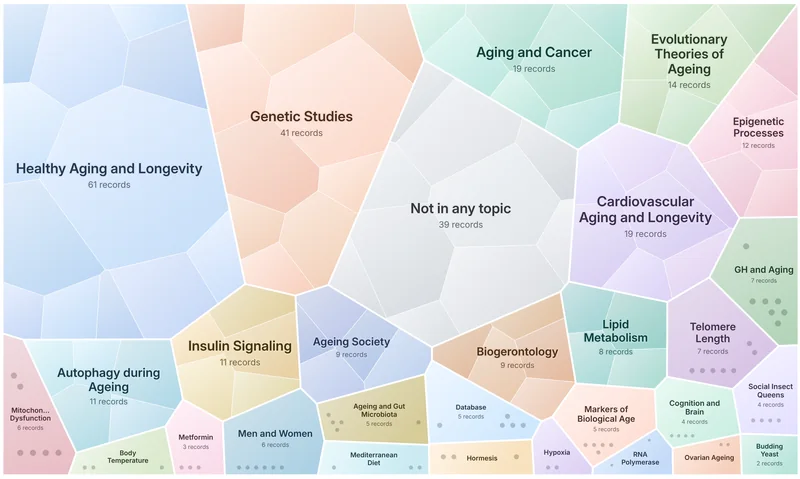
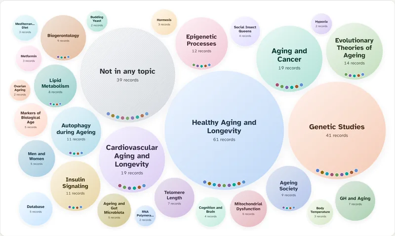
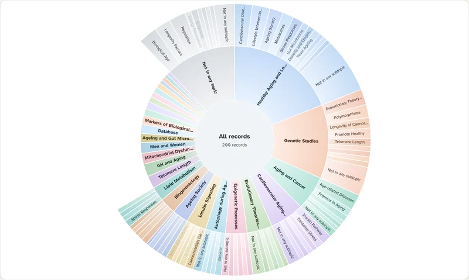
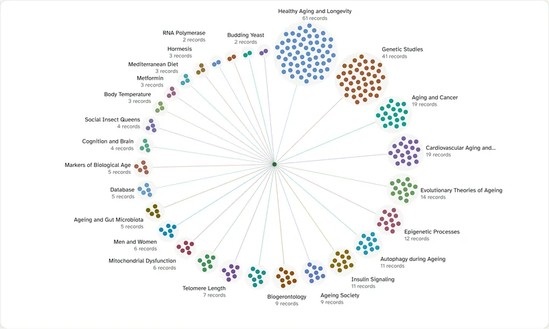

# Broccoli

**Read a literature as a map.** Broccoli groups search results into labelled
topics in the browser, with Lingo, Suffix Tree Clustering (STC) or bisecting
k-means, and draws them as zoomable maps. It comes with a PubMed search page:
type a query, and up to 2,000 records become a map of their topics. Click a
topic and Broccoli zooms in and clusters that topic's records again, so you
can go down level by level, up to six levels deep.

There is no server, no build step and nothing to install. Open `index.html`,
or put the folder on any static host. The library is one file with no
dependencies.

MIT License, © 2026 Decentralized Science Labs LLC.



A head of broccoli is a cluster of florets, and every floret is a cluster of
smaller ones; in Romanesco the same spiral repeats at every scale. Broccoli
reads a result set the same way: topics that open into subtopics, which open
again.

| Organic treemap | Bubbles | Radial | Florets |
|---|---|---|---|
|  |  |  |  |
| cells of a weighted power diagram, relaxed into organic shapes | circles packed to fill the map | a sunburst of up to three rings | a head of broccoli seen from above, one bud per record |

## Contents

```
index.html               the PubMed search page
app/                     its script, styles, colours, the maps and bundled fonts
dist/broccoli.js         the library as one classic script (window.Broccoli, or CommonJS)
dist/broccoli.mjs        the same library as an ES module
src/                     the library as ES modules, which dist/ is built from
examples/                small pages: your own documents, the PubMed API, ES modules
server/eutils-proxy.php  optional proxy that keeps an NCBI API key on your server
tests/                   browser test suite
tools/                   build.py, serve.py, run_tests.py (Python 3)
docs/GUIDE.md            how Broccoli reads text, finds topics and draws its maps
docs/PARAMETERS.md       every algorithm parameter, with defaults and ranges
CHANGELOG.md             what changed in each version
NOTICE.md                credits: the papers, JAMA, Snowball, the fonts, NCBI
CITATION.cff             how to cite Broccoli
```

## Quick start

1. Open `index.html` in a browser, from disk or from a web server.
2. Search PubMed, for example `long covid fatigue`, `senolytics` or
   `crispr[tiab] AND off-target`.

To serve the folder locally, run `python3 tools/serve.py` and open
http://localhost:8000/. `php -S localhost:8000` and other static servers work
too. To publish the page, copy `index.html`, `app/` and `dist/` to any static
host, such as GitHub Pages, Netlify, S3 or IPFS. With GitHub Pages turned on
for this repository (Settings → Pages → deploy from the `main` branch, root
folder), the page is served at `https://<owner>.github.io/Broccoli/`.

Opened from disk, everything works. Chrome blocks web fonts on `file://`
pages, so the page uses system fonts there.

## The search page

- **Search** takes full PubMed syntax: field tags, Boolean operators, MeSH
  terms. You choose how many records to cluster (100 to 2,000), the order
  (best match or newest) and the algorithm.
- **Fetching**: PMIDs come from ESearch, then records from EFetch in batches
  of 200, within NCBI's rate limit. A progress bar shows each stage. When a
  query finds nothing, the page offers NCBI's spelling suggestion.
- **Clustering** uses titles and abstracts, plus MeSH headings and author
  keywords if you turn them on. It runs in a Web Worker, so the page stays
  responsive.
- **Maps**: four ways to see the topics, all drawn in your browser and
  switchable at any time. The map spans the full width of the page and is as
  tall as the screen allows; a button shows it on the whole screen.
  - *Treemap* (the default): an organic treemap. Each topic is a cell of a
    weighted power diagram whose area is its share of the records, relaxed
    towards round shapes; subtopics are cells inside their topic's cell, and
    a topic too small to split shows its records as a honeycomb.
  - *Bubbles*: topics as circles packed to fill the map, sized by their
    records. Beads along the bottom of a bubble are its subtopics.
  - *Radial*: topics in a ring around the current group, with subtopics in
    the rings outside.
  - *Florets*: a head of broccoli seen from above. Each topic is a floret on
    a stem from the centre, and each of its records a bud on Vogel's
    sunflower spiral.

  The colours are eight matte hues in a fixed order, computed in OKLCH and
  checked for contrast and colour-blind separation in light and dark mode.
  Subtopics wear quiet variants of their topic's colour, and every shape
  carries its name, so colour is never the only cue. On phones the map runs
  edge to edge.
- **Zoom and cluster again**: click any topic, on the map or in the list, and
  the map zooms into it while Broccoli clusters its records into subtopics.
  Shapes morph from one level to the next. It keeps going as deep as the
  records allow, up to six levels; a group too small to split shows its
  records one by one. Zoom out with the path above the map, the Zoom out
  button, a click between the bubbles or on the centre of the radial map, the
  Escape key or the browser's back button. A second background worker
  clusters the topics you are likely to open next, so most zooms are instant.
- **Results**: the records of the topic you are in. Each record has an
  NLM-style citation, the words of the topic's label highlighted in context,
  structured abstract sections, MeSH terms, links to PubMed, PMC and the
  DOI, and flags for retractions and notable publication types.
- **Export** the records of the topic you are in as RIS (Zotero, EndNote,
  Mendeley), BibTeX or CSV. The CSV lists each record's subtopics. JSON
  saves the whole result: the query, the records and every level of topics
  explored so far. You can also copy the PMIDs, or open the records in
  PubMed.
- **Settings**:
  - search filters: years, has abstract, English, humans, free full text,
    reviews, clinical trials
  - text options: MeSH and keywords, a filter for scientific boilerplate, your
    own stop words and stop labels (with `*` wildcards), label style
  - every algorithm parameter
  - NCBI API key, contact e-mail and proxy address
  - theme: light, dark or system

  Settings are kept in this browser only.
- **Sharing**: the address bar holds the query, its options and filters, the
  map style and the topic you zoomed into (`#q=…&a=…&v=…&p=…`), so a view can
  be bookmarked or sent to someone, and finds the same records anywhere.
- **Keyboard**: `/` jumps to the search box. On the map, the arrow keys move
  between topics, Enter zooms in and Escape zooms out; a screen reader hears
  each topic's name and size.

## Using the library

### As a script

```html
<script src="dist/broccoli.js"></script>
<script>
  const docs = [
    { title: 'Jaguar unveils an electric grand tourer', snippet: 'A 700 km range…' },
    { title: 'Camera traps count jaguars in the Amazon', snippet: '…' },
    // …
  ];
  const result = Broccoli.cluster(docs, { algorithm: 'lingo', queryHint: 'jaguar' });
  for (const c of result.clusters) console.log(c.label, c.size, c.documents);
</script>
```

From a CDN, straight from this repository's tags:

```html
<script src="https://cdn.jsdelivr.net/gh/GenesisL1/Broccoli@v1.3.0/dist/broccoli.js"></script>
```

jsDelivr also serves a minified copy if you ask for `broccoli.min.js`.

### As an ES module

```js
import * as Broccoli from './dist/broccoli.mjs';   // or './src/index.js', the unbundled modules
const { cluster, PubMedClient } = Broccoli;
```

### In a Web Worker

```js
const clusterer = Broccoli.createClusterer();   // a worker when possible, else the same thread
const result = await clusterer.cluster(docs, {
  algorithm: 'stc',
  onProgress: (stage, fraction) => console.log(stage, fraction),
});
clusterer.mode;   // 'worker' or 'inline'
```

The single-file builds start their worker from their own source, so no extra
file is needed and it works on `file://` pages. With the modules in `src/`,
pass `{ workerUrl: 'src/worker-entry.js', workerType: 'module' }`.

### With PubMed

```js
const pubmed = new Broccoli.PubMedClient({ tool: 'my-app', email: 'me@example.org' /*, apiKey */ });
const query = 'crispr off-target';
const search = await pubmed.search(query, { retmax: 500, sort: 'pub_date', mindate: '2020' });
const articles = await pubmed.fetchArticles(search.ids, {
  onProgress: (done, total) => console.log(done, '/', total),
});
const result = Broccoli.cluster(Broccoli.toDocuments(articles, { includeMesh: true }), {
  preset: 'abstracts',
  queryHint: query,
  fields: ['title', 'abstract', 'terms'],
});
```

`Broccoli.searchPubMed(query, options)` does the search, the fetch and the
conversion in one call and returns `{ search, articles, documents }`.

### The maps on your own page

The maps are plain scripts too: `app/colors.js` (`BroccoliColors`),
`app/views.js` (`BroccoliViews`, the canvas maps) and `app/florets.js`
(`BroccoliFlorets`, the SVG florets map). `BroccoliViews.create(stage,
options)` draws a tree of topics into an element and takes `setData(root,
focus)`, `setFocus(node)`, `update()`, `setView(view)` and `refresh()`; set
`window.BroccoliFont` before loading it to choose the labels' font.
`app/app.js` shows how the search page builds the tree and wires them up;
[docs/GUIDE.md](docs/GUIDE.md) describes the layouts.

## API

### `cluster(documents, options) → result`

`documents` is an array of strings or of objects. Unless `fields` names the
fields to use, these are clustered when present: `title`, `snippet`,
`abstract`, `content`, `summary`, `description`, `body`, `text`, `terms` and
`keywords`. Documents with none of them contribute all their other text
fields, except identifiers such as `id`, `url` or `doi`. Field values may be
strings or arrays of strings.

| Option | Default | Meaning |
|---|---|---|
| `algorithm` | `'lingo'` | `'lingo'`, `'stc'` or `'bkm'` (also accepted: `'kmeans'`, `'bisecting-kmeans'`) |
| `preset` | `'default'` | `'default'` or `'abstracts'` (see Presets below) |
| `parameters` | `{}` | algorithm parameters, nested or dotted: `{ 'matrixBuilder.titleWordsBoost': 3 }`, listed in [docs/PARAMETERS.md](docs/PARAMETERS.md) |
| `language` | `'en'` | `'en'`, `'de'`, `'fr'`, `'es'`, `'it'`, `'pt'`, `'nl'`, `'ru'`, `'none'`, or one you register |
| `fields` | see above | field names to cluster, such as `['title', 'abstract']` |
| `titleField` | `'title'` | words in this field weigh more |
| `queryHint` | `''` | the query; its words are never a label on their own |
| `extras` | from the preset | language extras, such as `['biomedical']` |
| `dictionaries` | none | extra stop words and stop labels, described below |
| `labelFormat` | the language's | `'title'` (Title Case, English default), `'sentence'` (default elsewhere) or `'original'` |
| `otherTopics` | `true` | add a cluster with the documents no other cluster took |
| `otherTopicsLabel` | the language's | the name of that cluster, "Other topics" in English |
| `onProgress` | none | `(stage, fraction) => {}` |

Dictionaries add stop words and stop labels for one request:

```js
dictionaries: {
  wordFilters:  ['covid', { glob: ['sars*'] }, { regexp: ['^\\d+mg$'] }],          // stop words
  labelFilters: ['data mining', { glob: ['* cohort', 'case *'] }, { regexp: ['^about '] }],  // stop labels
}
```

In label globs, a lone `*` stands for any number of words. Matching ignores
case.

The result is plain JSON, so it can go through `postMessage` or be saved
as is:

```js
{
  algorithm: 'lingo', language: 'en', documentCount: 200,
  clusters: [
    { id: 0, label: 'Smoking Cessation', labels: ['Smoking Cessation'], size: 21, score: 0.83,
      documents: [3, 17, …], merged: ['Quit Rates'] },        // merged: labels folded into this one
    …,
    { id: 14, label: 'Other topics', labels: ['Other topics'], size: 31, score: 0, documents: […], other: true },
  ],
  unclustered: [ … ],              // documents in no real cluster
  stats: { … }, timings: { preprocessing: { … }, factorization: 41, total: 380 },
  parameters: { … },               // the parameters that were used
  warnings: [ … ],                 // unknown parameters, clamped values
  version: '1.3.0',
}
```

Lingo and STC clusters may overlap, so a document can belong to several.
Bisecting k-means puts each document in exactly one cluster. Randomised steps
draw from a seeded generator, so the same documents with the same options
always give the same clusters.

### Everything else

- **Engine**: `listAlgorithms()` (names, defaults and parameter descriptors,
  enough to build a settings form), `getAlgorithm()`, `resolveParameters()`,
  `PRESETS`, `VERSION`, `createClusterer()`.
- **PubMed**: `PubMedClient`, `searchPubMed()`, `EutilsError`, `toDocuments()`,
  `parsePubmedXml()`, `parseSearchXml()`, `parseSpellXml()`, `formatAuthors()`,
  `uninvertMesh()` ("Diabetes Mellitus, Type 2" becomes "Type 2 Diabetes
  Mellitus"), `parseXml()`.
- **Export**: `toRis(articles)`, `toBibtex(articles)`,
  `toCsv(articles, clusters)`, `toJson(result, articles)`.
- **Text**: `tokenize()`, `tokenizeToArray()`, `highlightHtml(text, labels, language)`,
  `highlightSpans()`, `escapeHtml()`, `registerLanguage()`, `getLanguage()`,
  `listLanguages()`, `isBuiltInLanguage()`, `wordStemmer()`, and the stemmers `stemEnglish`,
  `stemGerman`, `stemFrench`, `stemSpanish`, `stemItalian`, `stemPortuguese`,
  `stemDutch` and `stemRussian`.
- **Building blocks**: `preprocess()`, `lingo()`, `stc()`, `bisectingKMeans()`,
  `DenseMatrix`, `SparseMatrix`, `partialSvd()`, `factorize()`,
  `nmfEuclidean()`, `nmfKullbackLeibler()`, `localNmf()`, `sphericalKMeans()`,
  `lanczos()`, `symmetricEigen()`, `suffixArray()`, `lcpArray()`, `BitSet`,
  `createRandom()`.

### `PubMedClient`

```js
new PubMedClient({
  apiKey, email, tool = 'broccoli',
  baseUrl = 'https://eutils.ncbi.nlm.nih.gov/entrez/eutils/',   // or your proxy
  requestsPerSecond,            // 3; 10 with an API key or a proxy baseUrl (the proxy enforces the limit)
  maxRetries = 4, timeout = 45000, fetch,
})
```

- `search(term, { retmax, retstart, sort, datetype, mindate, maxdate, reldate, field, useHistory, signal })`
  returns `{ count, ids, queryTranslation, translations, warnings, errors, phrasesNotFound, webEnv, queryKey }`.
- `fetchArticles(ids, { batchSize = 200, signal, onProgress })` returns
  articles in the order of `ids`.
- `spell(term)` returns NCBI's suggested spelling, or `null`.
- `searchAndFetch(term, options)` returns `{ search, articles }`.

All of these queue requests to stay within the rate limit, which is shared by
every call on the same client. They retry on HTTP 429 and 5xx with backoff,
and stop when the `AbortSignal` you pass is aborted.

An article has these fields: `pmid`, `title`, `titleHtml`, `abstract`,
`abstractSections` (`[{ label, category, text, html }]`), `authors`,
`authorString`, `journal` (`{ title, isoAbbreviation, issn, volume, issue, pages }`),
`year`, `pubDate`, `articleDate`, `entryDate`, `doi`, `pmcid`, `mesh`
(`[{ descriptor, ui, major, qualifiers }]`), `keywords`, `publicationTypes`,
`languages`, `chemicals`, `status` and `url`. Book chapters from PubMed have
the same fields.

## Algorithms

| | Lingo | STC | Bisecting k-means |
|---|---|---|---|
| Idea | find abstract concepts first, then the phrase that names each one | group documents that share frequent phrases | split the largest cluster in two, again and again |
| Labels | one phrase per cluster, usually very descriptive | up to three phrases | the top terms of the cluster |
| Clusters | overlapping | overlapping | a partition |
| Best for | 100 to 2,000 abstracts or snippets | fast runs, phrase-heavy text | when every document must land somewhere |

- **Lingo** (Osiński, Stefanowski and Weiss, 2004) builds a term-document
  matrix (log tf-idf, with title words boosted) and factorizes it into
  concepts. The factorization is a partial SVD, as in the original algorithm,
  or one of the NMF variants (Osiński, 2006) or k-means. Each concept is
  named by the best of the documents' frequent phrases and words. A cluster
  gets every document that contains its label, and clusters that share most
  of their documents are merged.
- **STC** (Zamir and Etzioni, 1998) finds the phrases that documents share,
  using a suffix array in place of the suffix tree; the result is the same.
  Phrases become base clusters, scored by phrase length and document count,
  and base clusters that overlap strongly are merged.
- **Bisecting k-means** (Steinbach, Karypis and Kumar, 2000) runs spherical
  k-means on tf-idf vectors, optionally reduced by SVD first. For each split
  it tries several bisections and keeps the best one.

### Presets

- `default`: the algorithms' own defaults, with a generous allowance for the
  term-document matrix (2.5 million cells), since browsers handle that
  easily.
- `abstracts`: tuned for scientific abstracts, and used by the search page.
  Lingo uses NMF with fewer concepts and label generalization (below); STC
  ignores very common words and allows longer labels. The biomedical stop
  words and stop labels are on, so labels like "Control Group",
  "Patients with …" or "95% CI" are filtered out.

**Label generalization** is Broccoli's own addition to Lingo. When the phrase
chosen for a concept barely beats a shorter phrase inside it that covers at
least twice as many records, the concept takes the shorter one: "Breast
Cancer" (59 records) rather than "Breast Cancer Screening" (4). On a test set
of 422 trial abstracts it raised cluster purity from 0.82 to 0.86 and stopped
small changes to the stop lists from losing the largest topics. It is off in
the `default` preset.

### Design notes

- Text processing is Broccoli's own. The tokenizer is tuned for scientific
  text and keeps terms like `IL-6`, `COVID-19`, `CD4+`, `TNF-α` and
  `1.2–3.4` whole. The stop lists are its own too, and the stemmers were
  written from the Snowball descriptions.
- Lingo's SVD uses the Lanczos method with full reorthogonalization, which is
  exact to a relative residual of 1e-8.
- Bisecting k-means keeps the best of five trial bisections, skips splits that
  would leave a part smaller than `minClusterSize` (2 by default), and labels
  clusters with terms that are common inside the cluster and rare outside
  it.
- The clustering is lexical: topics come from shared words and phrases. There
  are no embeddings and no language model, so every label is made of words
  from the records, and synonyms that share no word stay apart.

## Languages

| Code | Language | Stemmer | Stop words |
|---|---|---|---|
| `en` | English | Porter2, Snowball 3 rules | yes, plus the `biomedical` extras |
| `de` `fr` `es` `it` `pt` `ru` | German, French, Spanish, Italian, Portuguese, Russian | Snowball | yes |
| `nl` | Dutch | Snowball, Porter's variant | yes |
| `none` | any other language that puts spaces between words | none | none |

Every stemmer was checked word for word against the Snowball reference
vocabularies (21,000 to 50,000 words each), and all of them match exactly.
Languages written without spaces, such as Chinese, Japanese and Thai, would
need a word segmenter, and Broccoli does not have one. To add a language:

```js
Broccoli.registerLanguage({
  code: 'sv', name: 'Swedish',
  stem: Broccoli.wordStemmer((w) => mySwedishStemmer(w)),
  stopwords: ['och', 'att', 'det', /* … */],
  stoplabels: ['^(?:ny|nya|olika)$'],
  labelFormat: 'sentence', otherTopics: 'Övriga ämnen',
});
```

A language you register exists only on the page that registered it, so
`createClusterer()` runs jobs in that language on the page's own thread
instead of in its worker.

## PubMed, NCBI and your API key

The E-utilities send CORS headers, so the browser can call NCBI directly and
no server of yours is involved. NCBI asks applications to:

- stay under 3 requests a second, or 10 with an API key. The client does
  this for you.
- identify themselves with `tool` and a contact `email`.
- get a free [API key](https://www.ncbi.nlm.nih.gov/account/settings/) for
  heavier use.

See NCBI's [usage guidelines](https://www.ncbi.nlm.nih.gov/books/NBK25497/).

To give every visitor the higher limit without asking for their key, deploy
`server/eutils-proxy.php` (PHP 7.4 or newer) with your key in it, then set
the page's "E-utilities address" setting, or `baseUrl` in code, to
`https://your.server/eutils-proxy.php?u=`. The proxy:

- forwards only the E-utilities and databases on its allow list.
- replaces any key the browser sends with yours, and removes your key from
  NCBI's error messages.
- spaces requests from all visitors to stay within the limit. A request that
  would wait more than 10 seconds gets HTTP 429, which the client retries.
- by default serves only pages from its own site. Set
  `BROCCOLI_ALLOWED_ORIGINS` if the search page lives elsewhere.

Setup notes are at the top of the file.

## Development

The project needs no Node.js or npm. Python 3 is used only for tooling.

- `python3 tools/build.py` rebuilds `dist/` from `src/`. Add `--check` to
  verify that `dist/` is current.
- `python3 tools/serve.py` serves the folder on http://localhost:8000/.
- `python3 tools/run_tests.py --system` runs the tests in the browser you
  already have and prints the results in the terminal. It needs nothing but
  Python. You can also open http://localhost:8000/tests/ (for `src/`) and
  `tests/dist.html` (for the single-file build) yourself.
- For headless runs, as in CI, `python3 tools/run_tests.py` uses Playwright
  for Python if it is installed. Playwright starts a driver of its own, which
  bundles a Node.js runtime; nothing comes from npm. To install it:

  ```
  python3 -m venv .venv && . .venv/bin/activate
  pip install playwright && python -m playwright install chromium
  ```
- The tests use a fake `fetch` and hand-written E-utilities responses, so they
  never touch the network.
- GitHub Actions runs the build check and the tests on every push
  (`.github/workflows/tests.yml`).

The page itself is `app/app.js` (search, topic tree, panels), `app/views.js`
(the canvas maps: the organic treemap, circle packing, the radial partition,
morphing and smooth zoom), `app/florets.js` (the florets map, SVG) and
`app/colors.js` (the palette).

Code layout of the library: `src/text` (tokenizer, stemmers, stop lists, highlighting),
`src/preprocessing` (words, stems, phrases, label candidates),
`src/matrix` (dense and sparse matrices, eigensolver, SVD, NMF, k-means),
`src/algorithms`, `src/engine` (parameters, presets, worker) and
`src/pubmed` (client, XML parser, records, exports).

## Browser support

Current Chrome, Edge, Firefox and Safari: anything from 2020 on with ES2019,
Unicode regular expressions and the canvas. The test suite and the page were
run in Chromium, at phone, tablet and desktop sizes from 320 pixels wide.

## Privacy

Clustering happens on your own device. The page sends nothing anywhere except
your queries, which go to NCBI, or to your proxy if you set one. There is no
analytics and there are no cookies. Settings, including an API key if you
enter one, are kept in this browser's local storage.

## Where Broccoli runs

[GL1X](https://gl1x.com), the explorer of the GenesisL1 blockchain, uses
Broccoli for its [PubMed search](https://gl1x.com/bio/pubmed), where every
molecular structure links to its literature. More about the project:
[genesisl1.com/broccoli](https://genesisl1.com/broccoli/).

## License

MIT, © 2026 Decentralized Science Labs LLC. See [LICENSE](LICENSE), and
[NOTICE.md](NOTICE.md) for credits to the papers the algorithms come from,
JAMA, Snowball, the fonts and NCBI.
